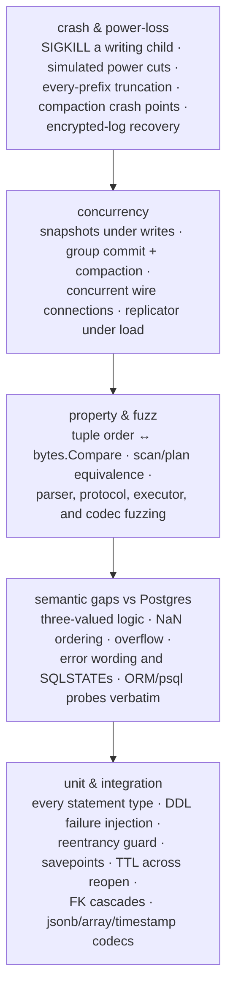

# Testing

bytdb's test suite is built around one conviction: **a storage engine's
correctness claims are only as good as its crash tests**. The suite covers
five tiers, from unit tests up to SIGKILL-under-load and simulated power
loss.

## Current coverage

Measured with `go test -count=1 -cover ./...` (Go 1.26.1, 2026-08-04):

| Package | Coverage | What it is |
|---|---:|---|
| `bytdb` (engine) | **77.7%** | Catalog, DDL, DML, indexes, foreign keys, transactions, OCC |
| `bytdb/sql` | **87.4%** | Lexer, parser, planner, executor, sessions, syscat |
| `bytdb/tuple` | **97.3%** | Order-preserving key encoding |
| `bytdb/stdlib` | **86.6%** | `database/sql` driver for the embedded engine |
| `bytdb/pgwire` | **88.0%** | Wire protocol server, SCRAM auth, TLS |
| `bytdb/replicate` | **80.4%** | Log shipping, generations, restore |
| `bytdb/replicate/s3` | **89.4%** | Dependency-free SigV4 S3 client |
| `btypedb` (storage) | **83.5%** | KV store, WAL, encryption, snapshots, TTL, compaction |

Across the repositories: **655 test functions** and **11 fuzz targets**.
(`pgwire/cmd/bytdbd` is a flag-parsing `main` and is intentionally untested.)

## The five tiers



### Crash safety (the tier that matters most)

- **`TestCrashRecovery`** (`btypedb/crash_test.go`) repeatedly SIGKILLs a child
  process that is writing 8-key batch transactions, then reopens and asserts
  the transactional invariant: every batch present after recovery has *all 8
  members with one identical value* — no torn or interleaved transaction ever
  survives — and the recovered store accepts new writes.
- **Power-loss simulation** (`powerfail_test.go`): a model filesystem where only
  fsync-promoted bytes survive a "cut", which then keeps an *arbitrary torn
  prefix* of in-flight bytes. `TestPowerLossEveryPrefix` replays recovery for
  every possible truncation point of the tail.
- **Compaction crash points** (`powerfailfs_test.go`): a cut during compaction
  leaves either the old or the new complete log, never a hybrid; leftover
  `.compact` temp files are proven dead.
- The bytdb layer adds its own `crash_test.go` plus **DDL failure injection**
  (`ddl_failure_test.go`): a hook simulates the WAL append failing at commit
  time, proving a failed `CREATE INDEX`/`ALTER` leaves no half-published
  schema.

### Property and fuzz tests

The 11 fuzz targets, by layer:

| Target | Invariant it defends |
|---|---|
| `FuzzTupleOrder` | `bytes.Compare(Encode(a), Encode(b))` ≡ semantic comparison — the load-bearing invariant of the whole design |
| `FuzzTupleRoundTrip` | decode ∘ encode is the identity |
| `FuzzParse` | no SQL text can panic the parser |
| `FuzzExec` | no parsed statement can panic the executor |
| `FuzzMessageParse` | no wire bytes can panic the protocol reader |
| `FuzzOpenRecord` | no log bytes can panic or corrupt WAL replay |
| `FuzzOpenEncryptedFile` | malformed encrypted logs fail cleanly, never crash or mis-decrypt |
| `FuzzJSONBCanon` | jsonb canonicalization is stable and round-trips |
| `FuzzTextArrayCanon` | text[] array-literal canonicalization round-trips |
| `FuzzTimestampRoundTrip` | timestamp codec round-trips across text/binary/key encodings |
| `FuzzUUIDRoundTrip` | uuid codec round-trips across text/binary/key encodings |

- `scan_property_test.go` and `sql/plan_property_test.go` cross-check scan and
  planner results against brute-force evaluation over generated data.
- `pgwire/panic_test.go` adds a panic fence test for the executor path.

### Fidelity to Postgres

`sql/semantic_gaps_test.go` and `sql/limits_test.go` pin the deliberate edge
behaviors: `NOT IN` with NULL collapsing to zero rows, NaN sorting last,
LIMIT/OFFSET overflow saturation, error wording (`operator does not exist`,
check-violation messages) matching Postgres closely enough that SQLSTATE
mapping works by message text. `pgwire/orm_test.go` and `sql/psql_test.go`
replay **verbatim** introspection queries captured from psql 17, GORM,
SQLAlchemy, and ActiveRecord.

### Differential tests against real Postgres

The pinned tests above cover the divergences somebody thought of.
`sql/difftest/` (its own module, so pgx stays out of the root module) finds
the rest: it runs a corpus of `.sql` files through bytdb and through a real
Postgres side by side, both driven by the same pgx client in the text
protocol, and compares every value and every column's type class (number,
text, bool, date, …). Rows compare as a multiset unless the entry says
`-- @ordered`.

Each known divergence carries an annotation on the line before it:

- `-- @todo D-xx: why` is a bug with a plan item. The run fails once the
  result starts matching Postgres, so the fix has to delete the line.
- `-- @bytdb: why` is a deliberate, documented divergence (the gotchas),
  with the same mechanics, meant to stay.

So the corpus is the living list of every known difference from Postgres,
and nothing starts or stops diverging silently. The file format is
documented at the top of `sql/difftest/corpus.go`.

The comparison runs only when `BYTDB_DIFF_PG_URL` names a Postgres to
compare against; each corpus file gets a fresh schema there, dropped
afterwards. Without the variable the suite still checks that every corpus
file parses.

```sh
# any disposable Postgres 16 will do, e.g.
docker run --rm -d -p 55432:5432 -e POSTGRES_PASSWORD=pg postgres:16
cd sql/difftest
BYTDB_DIFF_PG_URL='postgres://postgres:pg@127.0.0.1:55432/postgres?sslmode=disable' go test -v
```

## Continuous integration

`.github/workflows/ci.yml` (and the same file in btypedb) runs on every push
to `main` and every pull request:

| Job | What it checks |
|---|---|
| `test` | `go vet` and `go test -race` for the root module and `pgwire/`, on Linux and macOS, plus every benchmark once (`-benchtime=1x`) as a smoke test |
| `lint` | `gofmt -l` (outside `ai_docs/`) and `staticcheck` |
| `pgwire-no-replace` | `pgwire/go.mod` carries no `replace` (next-list N-031) |
| `pgwire-released-pin` | `GOWORK=off` build and test of `pgwire/` against the bytdb version it pins; **allowed to fail**, since a pgwire change that needs unreleased root API stays red until the next tag |
| `difftest` | the Postgres differential corpus against a `postgres:16` service container |
| `btypedb-main` | bytdb against btypedb `main` checked out beside it; **allowed to fail**, an early warning for cross-repo breakage |
| `fuzz` | nightly (and on manual dispatch): every fuzz target for 60 s; a failing input is uploaded as an artifact to commit as a seed |

The committed `go.work` names `../btypedb`, a sibling checkout that only
exists on a developer machine, so CI drops that entry and builds against
the btypedb version `go.mod` pins.

### Benchmarks are not a CI gate

Shared runners are too noisy to gate on timings, so CI only runs each
benchmark once to prove it still builds and runs. A change that claims a
performance win (or risks a loss) carries a `benchstat` comparison in its
commit or pull request instead:

```sh
go test -run='^$' -bench=BenchmarkX -count=10 ./sql > old.txt   # on the base commit
go test -run='^$' -bench=BenchmarkX -count=10 ./sql > new.txt   # with the change
benchstat old.txt new.txt
```

## Running the suite

```sh
# root module (engine, sql, tuple, replicate) — go.work covers pgwire too
go test ./...

# with coverage
go test -count=1 -cover ./...

# the other modules
(cd pgwire && go test -cover ./...)
(cd ../btypedb && go test -cover ./...)

# fuzzing (continuous; ctrl-C when satisfied)
go test -fuzz=FuzzTupleOrder ./tuple
(cd sql && go test -fuzz=FuzzParse)
```

The crash and power-loss tests run as part of the normal suite — no special
flags — which is why `btypedb`'s suite takes ~15 s.
